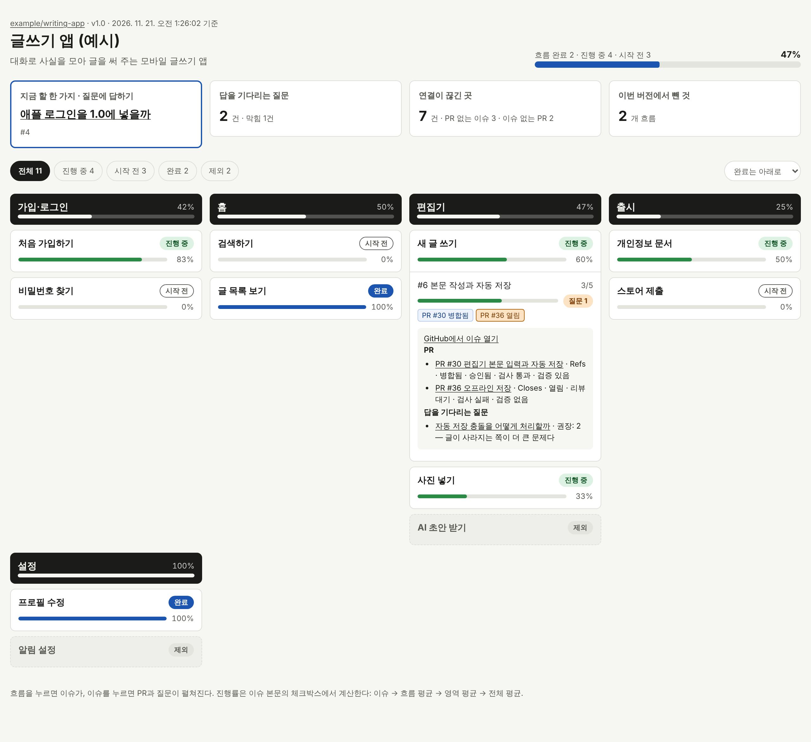

# flow-atlas

**프로젝트를 지도로 본다: 영역 → 사용자 흐름 → 이슈 → PR.**

AI 코딩 에이전트와 제품을 만드는 사람을 위한 GitHub 구성 규칙, 검사, 로컬 대시보드 묶음이다. 대화가 끝나면 사라지는 세 가지를 저장소에 남긴다: 무엇을 만드는지, 각 부분이 어디까지 왔는지, 무엇이 내 답을 기다리는지.

**[예시 화면 보기](https://shyuni4u.github.io/flow-atlas/ko/)** (예시 데이터) · [English README](README.md)



## 들어 있는 것

| 구성 | 역할 |
| --- | --- |
| `flow-atlas.json` | 영역과 사용자 흐름의 정본. `scope`가 `out`이면 이번 버전에서 뺀 흐름이다 |
| 이슈 양식 | 정본에서 생성한다. 흐름, 사용자가 얻는 결과, 체크박스 작업 항목이 필수다 |
| PR 템플릿과 검사 | 연결 이슈, 변경 유형, 검증이 비어 있으면 실패한다 |
| 라벨 | `area:*`, `flow:*`. 정본에서 만들고 이슈 양식의 선택으로 붙인다 |
| [결정 요청 댓글](docs/decision-comment.ko.md) | 오너에게 묻는 질문을 이슈·PR 댓글로 남기는 서식 |
| 대시보드 | HTML 한 장. 전체·영역·흐름 진행, 지금 할 한 가지, 대기 질문, 끊긴 연결 |

규칙 전문은 [docs/rules.ko.md](docs/rules.ko.md)에 있다. Node.js 20 이상과 [GitHub CLI](https://cli.github.com/)만 쓴다.

## 설치

```sh
cd <내 저장소>
npx github:shyuni4u/flow-atlas init --lang ko   # --pages 를 붙이면 Pages 워크플로도 넣는다
```

새 프로젝트와 기존 프로젝트에 같은 명령을 쓴다. `.github/flow-atlas/`에 도구를 복사하고, 없을 때만 `flow-atlas.json` 뼈대와 워크플로를 만들고, 이슈 양식과 PR 템플릿을 생성한다. 이미 있는 `flow-atlas.json`, 워크플로, 직접 쓴 PR 템플릿(관리 표시 `tracking-template`이 없는 파일)은 덮어쓰지 않는다. 다시 실행하면 도구만 최신으로 갱신한다.

설치 후 할 일:

1. `flow-atlas.json`에 영역과 흐름을 적고 `node .github/flow-atlas/bin/cli.mjs sync`를 실행한다.
2. `gh auth login` 상태에서 `sync --labels`로 라벨을 만든다.
3. PR 하나를 서식 그대로 비워서 올려 검사가 실패하는지 확인한 뒤, 저장소 설정에서 `PR 본문 규칙`을 필수 검사로 지정한다.
4. 에이전트 지침 파일에 [결정 요청 댓글](docs/decision-comment.ko.md)의 지침 문구를 넣는다.

기존 프로젝트에서는 과거 이슈와 PR을 고치지 않는다. 열린 이슈는 대시보드의 "흐름이 없는 이슈"에 모이므로, 계속할 이슈에만 `flow:` 라벨을 손으로 붙인다. 손으로 붙인 라벨은 이슈 본문이 다른 흐름을 가리키기 전까지 그대로 남는다. 저장소에 이미 PR이 있으면 `init`이 `flow-atlas.json`을 새로 만들 때 오늘 날짜(UTC)를 `"since"`로 적어, 그 날짜 전에 만든 PR을 끊긴 연결로 세지 않는다. 이미 `flow-atlas.json`이 있는 저장소에서는 `"since"`를 직접 적는다.

## 대시보드

서버 없이 여는 방법과 로컬 서버로 여는 방법이 있다.

```bash
# 1) 서버 없이: 파일을 만들고 브라우저로 연다. 다시 실행하고 새로고침하면 갱신된다
node .github/flow-atlas/bin/cli.mjs collect            # dashboard-out/index.html 을 더블클릭
node .github/flow-atlas/bin/cli.mjs collect --sample   # 예시 데이터

# 2) 로컬 서버: 화면의 동기화 아이콘으로 갱신한다
node .github/flow-atlas/bin/cli.mjs serve            # http://127.0.0.1:4173
```

`collect`는 데이터를 `index.html` 안에 넣어 파일 하나로 만든다. 브라우저는 `gh`를 실행할 수 없으므로, 화면에서 바로 동기화하려면 2)의 서버가 필요하다. 두 방법 모두 `gh` 로그인이 필요하다(예시 데이터 제외).

**필터와 정렬**: 지도 위의 상태 칩(전체, 진행 중, 시작 전, 완료, 제외)으로 흐름을 거른다. 정렬 기본값은 "완료는 아래로"다. 영역 안에서 진행 중 → 시작 전 → 완료 → 제외 순으로 놓고, 다 끝난 영역은 뒤로 보내며, 흐름 안에서는 닫힌 이슈를 아래에 둔다. 정본 순서, 진행률 높은 순, 낮은 순으로 바꿀 수 있고 선택은 브라우저에 기억된다.

2)의 서버로 열면 GitHub는 제목 옆의 **동기화 아이콘**을 누를 때와 자동 새로고침 때만 `gh`로 조회하고, 결과는 `dashboard-out/data.json`에 남아 다음에 열 때 바로 보인다.

- 아이콘에 마우스를 올리면 GitHub API 남은 양과 초기화 시각이 나온다. `gh`의 이슈·PR 목록 조회는 GraphQL 한도(로그인 기준 시간당 5,000)를 쓴다.
- 자동 새로고침은 5분 간격이고, 탭이 보일 때만 돈다. 남은 양이 한도의 20% 아래로 내려가면 멈추고 아이콘 동기화만 남는다.
- 동기화에 실패하면 아이콘 색이 바뀌고, 올려놓으면 이유가 나온다. 이전 화면은 그대로 남는다.
- 새로 그려도 펼쳐 둔 흐름과 이슈는 그대로 유지된다.
- 서버는 `127.0.0.1`에만 열리고, 다른 웹사이트가 동기화를 호출하지 못하게 주소와 전용 헤더를 확인한다.

처음에는 전체 진행률, 지금 할 한 가지, 대기 질문 수, 끊긴 연결 수, 영역과 흐름의 진행 막대만 보인다. 흐름에 마우스를 올리면 이슈·PR·질문 수가 나오고, 흐름을 누르면 이슈가, 이슈를 누르면 PR 상태와 질문이 펼쳐진다.

진행률은 이슈 본문의 체크박스에서 계산한다. 닫힌 이슈는 100%, 흐름은 소속 이슈의 평균, 영역과 전체는 범위 안 흐름의 평균이다. 작업량을 반영한 수치가 아니라 방향을 보는 간접 지표다.

이슈와 PR의 연결은 PR 본문의 `Closes #n`, `Refs #n`을 직접 읽는다. 

## `flow-atlas.json` 형식

```json
{
  "product": "제품 이름",
  "version": "v1.0",
  "lang": "ko",
  "areas": [
    {
      "id": "login",
      "name": "가입·로그인",
      "flows": [
        { "id": "signup", "name": "처음 가입하기", "scope": "in" },
        { "id": "reset", "name": "비밀번호 찾기", "scope": "out" }
      ]
    }
  ]
}
```

`id`는 영문 소문자·숫자·하이픈 20자 이내이고 라벨(`area:login`, `flow:login/signup`)에 쓰인다. 이미 이슈가 달린 `id`를 바꾸면 예전 라벨이 남으므로 이름을 바꿀 때는 `name`만 고친다.

`"since": "2026-11-22"`는 선택 항목이다. 그 날짜(UTC)보다 먼저 만든 PR은 "이슈 없는 PR"과 "검증이 비어 있는 PR"에서 빠지고, 화면에 빠진 건수가 나온다. 이슈와의 연결은 지도에 그대로 보인다. `since`가 없으면 모든 PR을 센다.

## 언어

화면, 이슈 양식, PR 템플릿, 명령 출력은 한국어와 영어를 지원한다. `flow-atlas.json`의 `"lang"`(`ko` 또는 `en`)으로 정하고, 설치할 때 `--lang`으로 지정할 수 있다. 지정하지 않으면 시스템 언어를 따르고 모르면 영어다. PR 본문 검사와 결정 요청 댓글은 두 언어의 항목 제목과 키워드를 모두 읽으므로, 언어를 바꿔도 예전 PR과 댓글이 그대로 집계된다.

## GitHub Pages

기본은 내 컴퓨터에서 여는 방식이다. 저장소가 공개든 비공개든 똑같이 동작하고 내 `gh` 로그인으로 볼 수 있는 것만 보인다. Pages는 `init --pages`로 따로 켠다. 무료 플랜의 비공개 저장소에서는 Pages를 쓸 수 없고, Pro·Team에서는 비공개 저장소의 Pages 사이트도 누구나 볼 수 있어 이슈 제목과 질문 댓글이 공개되기 때문이다. 켜기 전에 GitHub 문서로 현재 조건을 확인한다.

## 검사가 보지 않는 것

- PR 본문 검사는 항목이 채워졌는지만 본다. 적힌 이슈 번호가 실제로 있는지, 검증 내용이 사실인지는 판정하지 않는다.
- 양식을 거치지 않고 만든 이슈는 `needs-flow` 라벨로만 드러난다. 생성을 막지는 않는다. `flow:` 라벨을 손으로 붙이면 `needs-flow`는 떨어진다.
- 라벨 동기화는 목록에서 빠진 예전 라벨을 지우지 않는다.

## 상태

초기 공개판(0.1)이다. 데이터 계산, PR 본문 검사, 라벨 판단은 테스트(`npm test`)로 확인한다. 라벨 워크플로와 Pages 워크플로는 실제 사용 경험이 적다.

## 라이선스

[MIT](LICENSE)
