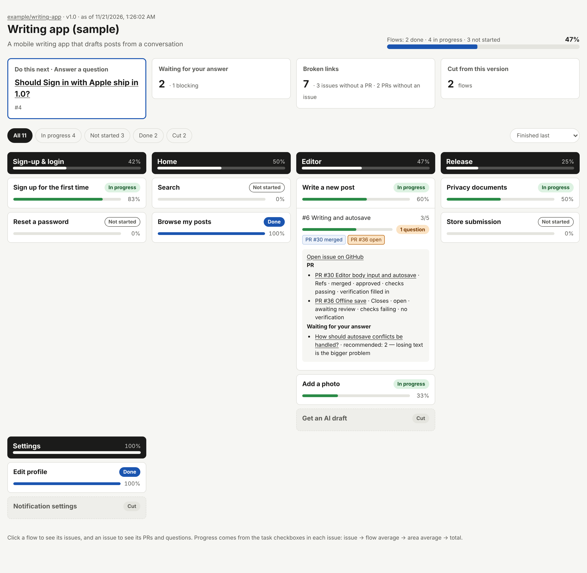

# flow-atlas

**See your project as a map: areas → user flows → issues → pull requests.**

flow-atlas is a small set of GitHub conventions, checks, and a local dashboard for people building products with AI coding agents. It answers three questions that get lost between chat sessions: *what are we building, how far along is each part, and what is waiting on me?*

**[Live demo](https://shyuni4u.github.io/flow-atlas/)** (sample data) · [한국어 README](README.ko.md)



## Why

Working with an AI agent, implementation is cheap and the plan evaporates. Issues pile up without a shape, pull requests appear that no issue asked for, and the questions the agent asked you last week are buried in a chat log. flow-atlas keeps the plan in the repository and makes the gaps visible:

- **One file is the plan.** `flow-atlas.json` lists your product's areas and user flows, including the flows you deliberately cut from this version.
- **Issues say what and why. Pull requests say how and how it was verified.** A form and a check keep both honest.
- **Every issue belongs to a flow, every PR points at an issue.** Issues with no PR and PRs with no issue show up as "broken links".
- **Questions for the owner live in comments.** When the agent needs a decision it leaves a structured comment on the issue or PR, and the dashboard lists the ones still waiting.

## What you get

| Piece | What it does |
| --- | --- |
| `flow-atlas.json` | Source of truth for areas and user flows |
| Issue form | Generated from that file. Requires a flow, a user-facing outcome, and a task checklist |
| PR template + check | Fails a PR whose body has no linked issue, no change type, or an empty verification section |
| Labels | `area:*` and `flow:*`, created from the file and applied from the issue form |
| Decision comments | A comment format for questions that need the owner's answer |
| Dashboard | A single HTML page: overall, area and flow progress, the one thing to do next, open questions, broken links. Details expand on click or hover |

The rules are written out in [docs/rules.md](docs/rules.md). No dependencies beyond Node.js 20+ and the [GitHub CLI](https://cli.github.com/).

## Quick start

```sh
cd your-repo
npx github:shyuni4u/flow-atlas init
```

`init` works the same for a new or an existing repository. It copies the tool into `.github/flow-atlas/`, creates a starter `flow-atlas.json`, generates the issue form and PR template, and adds a workflow. It never overwrites an existing `flow-atlas.json`, workflow, or a PR template you wrote yourself.

Then:

```sh
# 1. edit flow-atlas.json: your areas and user flows
node .github/flow-atlas/bin/cli.mjs sync            # regenerate the issue form
node .github/flow-atlas/bin/cli.mjs sync --labels   # create labels (needs `gh auth login`)
git add -A && git commit -m "Add flow-atlas"

# 2. open the dashboard
node .github/flow-atlas/bin/cli.mjs collect         # writes dashboard-out/index.html, just open the file
node .github/flow-atlas/bin/cli.mjs serve           # or run a local server with a sync button
```

To try it without a repository: `npx github:shyuni4u/flow-atlas collect --sample`, then open `dashboard-out/index.html`.

In an existing project nothing is rewritten. Open issues without a flow are listed under "issues without a flow"; add a `flow:` label by hand to the ones you intend to continue and leave the rest. A hand-applied label stays until the issue body names a different flow. When the repository already has pull requests and `init` creates `flow-atlas.json`, it writes today's date (UTC) as `"since"`, so pull requests created before that date are not counted as broken links. If `flow-atlas.json` already exists, add `"since"` yourself.

## How it works

### `flow-atlas.json`

```json
{
  "product": "Writing app",
  "version": "v1.0",
  "lang": "en",
  "areas": [
    {
      "id": "login",
      "name": "Sign-up & login",
      "flows": [
        { "id": "signup", "name": "Sign up for the first time", "scope": "in" },
        { "id": "reset", "name": "Reset a password", "scope": "out" }
      ]
    }
  ]
}
```

`id` values become labels (`area:login`, `flow:login/signup`), so rename with `name` and keep `id` stable. `"scope": "out"` keeps a flow on the map as "cut from this version" instead of deleting it.

`"since": "2026-11-22"` is optional. Pull requests created before that date (UTC) are left out of "PRs without an issue" and "PRs with empty verification"; the dashboard states how many were left out. Their links to issues still show on the map. Without `since`, every pull request is counted.

`"shipped": true` on a flow is optional. It marks a flow that was already built before flow-atlas was installed, so the map does not show finished work as "not started". The flow counts as if it had one closed issue: 100% and done with no issues, in progress again once an open issue is added. It is a statement you make in the file, not something flow-atlas checks.

### Issues and pull requests

- An issue belongs to exactly one flow and lists its work as checkboxes. Progress is read from those checkboxes.
- A PR body must contain one of `Closes #n` (this PR finishes the issue), `Refs #n` (partial work), or `No issue: <reason>` (unplanned work, stated openly), plus a checked box under `## Change type` and a non-empty `## Verification` section.
- GitHub only records `Closes` as a link when the PR targets the default branch. flow-atlas reads the PR body itself, so `Refs` and non-default branches still show up on the map.

### Decision comments

When an agent needs your call, it leaves one comment per question, starting with `### Decision needed:` and carrying a status (`waiting`, `decided`, `withdrawn`), whether it blocks work, the options, and a recommendation. When answered, the same comment is edited rather than a new one added. The format and a snippet for your `AGENTS.md` / `CLAUDE.md` are in [docs/decision-comment.md](docs/decision-comment.md).

### Dashboard

- **First view:** overall progress, the one thing to do next, counts of open questions and broken links, and a progress bar per area and flow.
- **Hover** a flow or area for issue, PR and question counts. **Click** a flow to see its issues; click an issue to see each PR's state (review, checks, verification) and its questions.
- **Filter** by status and **sort** with finished work at the bottom (default), plan order, or by progress.
- **Progress** is derived, not entered: issue = checked tasks (closed = 100%), flow = average of its issues, area and total = average of in-scope flows. It shows direction, not effort. The one entered value is `shipped`, which adds one finished item to a flow.
- `collect` embeds the data in the HTML, so the file opens without a server. `serve` adds a sync icon next to the title, shows remaining GitHub API quota on hover, and refreshes every 5 minutes while quota is above 20%. The server listens on `127.0.0.1` only.

### GitHub Pages

The dashboard is local by default, which works the same for public and private repositories and only shows what your own `gh` login can read. Pages is opt-in (`init --pages`) because of how GitHub plans work: Pages is unavailable for private repositories on the Free plan, and on Pro/Team a private repository's Pages site is still **public**, which would expose issue titles and decision comments. Check GitHub's current documentation before enabling it.

## Commands

| Command | What it does |
| --- | --- |
| `init [dir] [--lang en\|ko] [--pages]` | Install into a repository, or update an existing install |
| `sync` | Generate the issue form and PR template from `flow-atlas.json` |
| `sync --check` | Fail if generated files are stale (for CI) |
| `sync --labels` | Create or update labels with `gh` |
| `collect [--sample] [--out dir]` | Build the dashboard as a single HTML file |
| `serve [--port n] [--sample]` | Serve the dashboard locally with a sync icon |

## Language

The dashboard, issue form, PR template and command output come in English and Korean. Set `"lang"` in `flow-atlas.json` to `en` or `ko`, or pass `--lang` to `init`. Without either, flow-atlas follows the system locale and falls back to English.

The PR check and the decision-comment parser accept the headings and keywords of both languages, so switching language later does not orphan existing pull requests or comments.

## What the checks do not do

- The PR check verifies that sections are filled in, not that the issue number exists or that the verification is true.
- Issues created without the form are flagged with `needs-flow`, not blocked. A `flow:` label you add by hand replaces it.
- Label sync never deletes labels that were removed from `flow-atlas.json`.

## Status

Early release (0.1). The model, the PR check and the label choice are covered by tests (`npm test`); the label workflows and the Pages workflow have seen little real-world use. Please open an issue if something breaks.

## License

[MIT](LICENSE)
